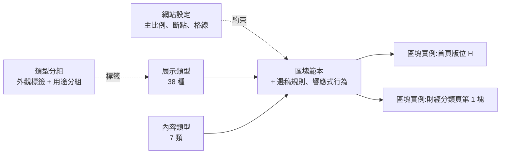

# 新聞首頁區塊架構定義

Nov 3, 2026 · @EZ

## 目的與範圍

本文件把新聞首頁的區塊分成五個面向,並統一術語,讓設計、工程與編輯用同一套說法溝通。範圍是首頁與分類頁的內容區塊,不含導覽列、頁尾與廣告版位。

展示類型的視覺範例另見 [新聞版型圖鑑](../catalog/index.html)。

其他文件:JSON 定義見 [資料結構](02-data-structure.md),評估與驗收見 [驗收標準](03-acceptance.md)。

評估工具的規劃(兩段式評估、改進建議、Node.js 與 AI 分工)見 [評估工具](04-evaluator.md)。

問題類型對照表與評估實例見 [評估實例](05-examples.md)。

## 術語表

七個術語分三類:網站設定約束全站;展示類型、內容類型與兩種分組描述區塊;區塊範本與實例是組合後的結果。外觀標籤與用途分組合稱「類型分組」。

| 術語 | 英文 | 定義 | 例子 |
| --- | --- | --- | --- |
| 網站設定 | Site profile | 全站唯一的設定,決定主比例、斷點與格線,範本與實例不能覆寫 | 平面媒體站,主比例 3:2 |
| 展示類型 | Layout pattern | 區塊怎麼排的抽象型式,與內容無關 | 型 09 首 1 則放大,其餘純文字 |
| 內容類型 | Content type | 區塊放什麼 | 新聞(財經)、影音 |
| 外觀標籤 | Pattern tag | 依長相附在展示類型上的標籤,一型可有多個,只供篩選 | 圖、文、混合、輪播、放大 |
| 用途分組 | Pattern group | 依用途把展示類型分成 5 組,每型只屬一組,只供瀏覽 | 新聞組合、影音與廣播 |
| 區塊範本 | Block template | 內容類型 + 展示類型 + 選稿規則 + 響應式行為組成的可重複使用規格 | 財經區塊 |
| 區塊實例(版位) | Block instance | 區塊範本放在某頁某位置的那一份,填入實際新聞 | 首頁版位 H 的財經區塊 |

工程文件與系統用「區塊實例」,編輯後台的介面顯示為「版位」。

## 架構總覽

網站設定約束全站;展示類型和內容類型組成區塊範本,範本放上頁面成為區塊實例。

類型分組只附在展示類型上,不參與組成;同一個範本可以有多個實例。

## 網站設定

網站設定全站只有一份,主比例、斷點和格線都由它決定,範本與實例不能覆寫。

| 欄位 | 設定值 | 說明 |
| --- | --- | --- |
| 媒體類型 | 平面或影視 | 決定主比例 |
| 主比例 | 平面 3:2、影視 16:9,二選一 | 展示類型裡標「主比例」的圖片位置都用它 |
| 1:1 | 一律可用 | 排行縮圖、方形輪播、圖片牆、作者頭像等固定用 1:1 |
| 主切換點 | 992px | 手機與電腦排法的分界 |
| 測試寬度 | 360、390、768、1024、1280、1440px | 驗收時固定量這 6 種 |
| 格線 | 12 欄,欄距 1rem | Bootstrap 或 Tailwind 都能實作 |
| 容器最大寬 | 1200px | 示意值,依網站設計調整 |
| 比例容許誤差 | 1% | 見圖片比例規範 |

## 展示類型

展示類型共 38 種,每種用下列 7 個屬性描述;前 20 種的視覺範例見 [新聞版型圖鑑](../catalog/index.html)。

| 屬性 | 可能值 |
| --- | --- |
| 排列 | 單一、清單、網格、拼貼、輪播、分頁 |
| 強調 | 無、首 1 則放大、首 2 則放大 |
| 圖文關係 | 圖上文下、左圖右文、HTML 疊字、無圖 |
| 文字量 | 只有標題、標題加摘要、段落 |
| 圖片 | 主比例、1:1、無圖(主比例由網站設定決定) |
| 則數範圍 | 建議的最少到最多則數 |
| 互動 | 無、輪播切換、分頁籤切換、跑馬燈、播放、展開收合、投票 |

**新型式還是變體**:排列方式、互動方式或內容結構不同,才算新型式;只差欄數、則數、主比例或文字量,算同一型的變體,用參數處理。型式總數以 40 種為上限,超過通常表示把變體當成了新型式。

| 型 | 名稱 | 用途分組 | 外觀標籤 | 則數 | 圖片 |
| --- | --- | --- | --- | --- | --- |
| 01 | 大圖疊字 | 新聞組合 | 圖、放大 | 1 | 主比例 |
| 02 | 大圖下文 | 新聞組合 | 圖 | 1 | 主比例 |
| 03 | 左圖右文 | 新聞組合 | 混合 | 3–6 | 主比例或 1:1 |
| 04 | 純文字清單 | 文字為主 | 文 | 5–10 | 無圖 |
| 05 | 編號排行 | 文字為主 | 文 | 5–10 | 1:1 或無圖 |
| 06 | 時間軸 | 文字為主 | 文 | 3–8 | 無圖 |
| 07 | 均分圖卡網格 | 新聞組合 | 圖 | 3–9 | 主比例 |
| 08 | 首 1 則放大,其餘小卡 | 新聞組合 | 混合、放大 | 5 | 主比例 |
| 09 | 首 1 則放大,其餘純文字 | 新聞組合 | 混合、放大 | 4–6 | 主比例 |
| 10 | 首 2 則放大,其餘小卡 | 新聞組合 | 混合、放大 | 6 | 主比例 |
| 11 | 拼貼(Bento) | 新聞組合 | 圖、放大 | 3–7 | 主比例與 1:1 |
| 12 | 橫式輪播 | 影音與廣播 | 輪播、圖 | 4–12 | 主比例 |
| 13 | 方形輪播 | 影音與廣播 | 輪播、圖 | 4–12 | 1:1 |
| 14 | 寬幅專題 | 新聞組合 | 圖、放大 | 1–2 | 主比例 |
| 15 | 分頁籤切換 | 互動、導覽與推廣 | 混合 | 每頁 3–6 | 主比例、1:1 或無圖 |
| 16 | 圖片牆 | 新聞組合 | 圖 | 1 則圖輯,6–12 張 | 1:1 |
| 17 | 作者卡 | 文字為主 | 混合 | 3–6 | 1:1 |
| 18 | 大字無圖標題卡 | 文字為主 | 文、放大 | 1–3 | 無圖 |
| 19 | 跑馬燈 | 文字為主 | 文 | 3–10 | 無圖 |
| 20 | 圖表卡 | 數據與資訊 | 圖 | 1–3 | 主比例 |
| 21 | 主新聞群組 | 新聞組合 | 混合、放大 | 1 + 2–4 條連結 | 主比例 |
| 22 | 單一影片播放器 | 影音與廣播 | 圖、放大 | 1 | 16:9(影片固定) |
| 23 | 音訊 / Podcast 清單 | 影音與廣播 | 混合 | 3–8 | 1:1 或無圖 |
| 24 | 節目表 / 直播時段 | 影音與廣播 | 文 | 4–12 個時段 | 無圖 |
| 25 | 數字卡 | 數據與資訊 | 文、放大 | 1–4 | 無圖 |
| 26 | 地圖卡 | 數據與資訊 | 圖 | 1 | 主比例 |
| 27 | 引言卡 | 文字為主 | 文、放大 | 1 | 無圖 |
| 28 | 熱門話題標籤列 | 互動、導覽與推廣 | 文 | 5–12 | 無圖 |
| 29 | 分類導覽列 | 互動、導覽與推廣 | 文 | 3–8 | 無圖 |
| 30 | 投票 / 民調 | 互動、導覽與推廣 | 混合 | 1 | 主比例或無圖 |
| 31 | 摺疊問答 | 互動、導覽與推廣 | 文 | 3–8 | 無圖 |
| 32 | 訂閱 / 電子報招募 | 互動、導覽與推廣 | 混合 | 1 | 主比例或無圖 |
| 33 | 資訊小工具 | 數據與資訊 | 混合 | 1–3 | 無圖 |
| 34 | 無限載入動態 | 新聞組合 | 混合 | 不限,每次載入約 10 | 主比例 |
| 35 | 新聞簡報 | 文字為主 | 文 | 3–6 條 | 無圖 |
| 36 | 重點整理 | 文字為主 | 文 | 3–5 點 | 無圖 |
| 37 | 直播文字 | 文字為主 | 文 | 不限 | 無圖 |
| 38 | 背景說明框 | 文字為主 | 文 | 1 | 無圖 |

型 21\~38 的則數與圖片為建議值,尚未製作範例。

## 內容類型

內容類型共 7 類。政治、財經、國際等分類是「新聞」的子屬性,不另立面向。

| 內容類型 | 說明 | 常用展示類型 |
| --- | --- | --- |
| 新聞 | 文字報導,依分類細分 | 01、02、03、07、08、09、10 |
| 快訊 | 即時更新的短訊 | 06、19 |
| 影音 | 影片、短影音、Podcast | 12、13 |
| 觀點 | 專欄、社論、評論 | 17、18 |
| 圖表 | 數據新聞、選舉、行情 | 20 |
| 專題 | 跨多則的企劃入口 | 11、14 |
| 推廣 | 電子報、App、自家活動 | 14 |

## 類型分組

類型分組有兩個維度,都只用來瀏覽和篩選,不參與區塊範本的組成:外觀標籤看長相,一型可以有多個;用途分組看用途,每型只屬一組。

### 外觀標籤

| 標籤 | 條件 |
| --- | --- |
| 圖 | 以圖片為主體 |
| 文 | 無圖,或以文字為主 |
| 混合 | 圖片與純文字條目並存 |
| 輪播 | 有左右切換 |
| 放大 | 至少一則放大強調 |

### 用途分組

| 用途分組 | 型數 | 包含的型 |
| --- | --- | --- |
| 新聞組合 | 12 | 01、02、03、07、08、09、10、11、14、16、21、34 |
| 影音與廣播 | 5 | 12、13、22、23、24 |
| 數據與資訊 | 4 | 20、25、26、33 |
| 文字為主 | 11 | 04、05、06、17、18、19、27、35、36、37、38 |
| 互動、導覽與推廣 | 6 | 15、28、29、30、31、32 |

## 區塊範本

區塊範本是可重複使用的規格,由下列 7 個欄位組成。範本改動會套用到所有引用它的實例。

| 欄位 | 說明 | 範例:財經區塊 |
| --- | --- | --- |
| 名稱 | 範本的識別名稱 | 財經區塊 |
| 內容類型 | 7 類之一,可加分類 | 新聞(財經) |
| 展示類型 | 38 種之一 | 型 09 首 1 則放大,其餘純文字 |
| 則數 | 在展示類型的範圍內取定值 | 6 |
| 選稿規則 | 新聞從哪裡來、怎麼排 | 首則編輯手選,其餘自動最新 |
| 響應式行為 | 各斷點的欄數或改變的型式 | 桌面左右並排,手機改上下堆疊 |
| 區塊標題與連結 | 顯示名稱,以及「更多」連到哪裡 | 財經,連到財經分類頁 |

選稿規則有 4 種:

- **編輯手選**:編輯逐則指定。
- **自動最新**:依發布時間取最新的 n 則。
- **依熱門排序**:依閱讀量取前 n 則。
- **混合**:前 n 則編輯手選,其餘自動補上。

## 區塊實例(版位)

實例引用一個範本,放在某頁的某個位置,再依選稿規則填入實際新聞。實例可以覆寫少數設定,覆寫只影響自己。

| 欄位 | 說明 | 範例 1 | 範例 2 |
| --- | --- | --- | --- |
| 引用範本 | 一個區塊範本 | 財經區塊 | 財經區塊 |
| 所在頁面 | 首頁或分類頁 | 首頁 | 財經分類頁 |
| 位置 | 頁面上的順序 | 版位 H(第 8 塊) | 第 1 塊 |
| 覆寫設定 | 只能覆寫則數、選稿規則、區塊標題 | 無 | 選稿規則改為全部自動最新 |
| 目前內容 | 依選稿規則填入的實際新聞 | 6 則 | 6 則 |

覆寫有兩條限制:

- 展示類型與圖片比例不可覆寫,要改就另建範本。
- 覆寫後的則數仍要在展示類型的範圍內,例如型 09 只能是 4–6 則。

## 響應式規則

只用 RWD:同一份 HTML 依螢幕寬度改變排列,以 992px 為主切換點。

- **比例不隨裝置改變**:主比例全站固定,RWD 只改欄數與排列,不重新裁圖。
- **則數不因裝置刪減**:太長就改輪播或加「看更多」,不在手機上藏稿。
- **側欄在手機上移入主欄**:熱門、快訊等側欄區塊排到主欄適當位置。
- **平板取中間值**:大多沿用電腦版欄數減一欄。

「斷點下換型」(例如型 01 在手機改成型 02)屬於區塊範本的響應式行為,寫進範本即可,不另建範本。

| 型 | 名稱 | 手機(< 992px) | 電腦(≥ 992px) |
| --- | --- | --- | --- |
| 01 | 大圖疊字 | 全寬,疊字限兩行;圖太扁時改型 02 | 主欄全寬,疊字加摘要 |
| 02 | 大圖下文 | 全寬 | 主欄寬,結構相同 |
| 03 | 左圖右文 | 單欄,縮圖約 1/3 寬 | 縮圖約 1/4 寬,或兩欄並排 |
| 04 | 純文字清單 | 單欄 | 側欄單欄,或主欄兩欄 |
| 05 | 編號排行 | 單欄,先顯示前 5 則 | 側欄單欄 |
| 06 | 時間軸 | 單欄 | 側欄單欄 |
| 07 | 均分圖卡網格 | 2 欄 | 3–4 欄 |
| 08 | 首 1 則放大,其餘小卡 | 大圖全寬,小卡 2 欄在下 | 左 8 右 4,小卡 2×2 |
| 09 | 首 1 則放大,其餘純文字 | 大圖全寬,清單在下 | 左右並排,約 8:4 |
| 10 | 首 2 則放大,其餘小卡 | 兩則大圖上下堆疊,小卡 2 欄 | 大圖 2 欄,小卡 4 欄 |
| 11 | 拼貼 | 主圖全寬,其餘 2 欄 | 主圖 2/3 + 側邊 2 格,下排 4 格 |
| 12 | 橫式輪播 | 一次約 1.2 張,手指滑動 | 一次 3–4 張,加左右箭頭 |
| 13 | 方形輪播 | 一次約 2.2 張 | 一次 5–6 張 |
| 14 | 寬幅專題 | 圖上文下 | 左圖右文,約 7:5 |
| 15 | 分頁籤切換 | 分頁籤可橫向捲動 | 分頁籤一列排開 |
| 16 | 圖片牆 | 3 欄 | 6–8 欄 |
| 17 | 作者卡 | 2 欄,或橫向捲動 | 4 欄 |
| 18 | 大字無圖標題卡 | 單欄,字級縮小 | 2–3 欄並排 |
| 19 | 跑馬燈 | 速度放慢,或改單則輪替 | 單列跑馬燈 |
| 20 | 圖表卡 | 全寬,標籤精簡 | 依所在欄寬 |

型 21\~38 的手機與電腦排法尚未定義。

## 圖片比例規範

圖片位置一律用網站設定的主比例:平面媒體 3:2、影視媒體 16:9,全站二選一;1:1 一律可用。實務上常見前端大量用 contain 留白,造成圖檔與圖框比例不一致,本規範就是為此而訂。

- **後端裁圖**:圖檔在後端裁成主比例(及 1:1),前端不靠 object-fit 的 contain 或 cover 湊比例。
- **高度由寬度推算**:圖片框用 CSS aspect-ratio,不得被版面拉伸。
- **禁止直式**:任何圖片都不得是直式;短影音用型 13 方形輪播,專題橫幅用型 14 寬幅專題。
- **頭像**:1:1,可圓形裁切。
- **檢驗標準**:顯示寬高比與主比例(1.5 或 1.778)或 1.0 相差不得超過 1%。

影片例外:影片播放器與影片縮圖一律 16:9,不受網站主比例限制;4:3、9:16 等其他影片比例暫不納入。比例只是高度公式裡的參數,換成任何比例,評估與試算機制都一樣適用。

待決事項:

- [x] 1:1 一律可用,3:2 與 16:9 二選一(已決定)
- [x] 影片一律 16:9,不受主比例限制(已決定)

## 首頁配置原則

首頁建議 10\~15 個內容區塊、整頁 30\~80 則新聞,不含導覽、頁尾與廣告。精簡型網站可少到 6\~10 塊;18 塊以上或 80 則以上就偏長,讀者很難看完。

- **只能有一塊**:頭條、熱門排行、即時快訊。
- **可以多塊**:分類版區、影音、專題、圖表;次頭條在首頁一組,但各分類版區內可各有一組。
- **介於兩者**:觀點評論通常一塊,也可在分類下各放一塊。

| 區塊 | 建議則數 |
| --- | --- |
| 頭條 | 1 |
| 次頭條 | 3–6 |
| 即時快訊 | 3–5 |
| 熱門排行 | 5–10 |
| 分類版區 | 4–8 |
| 影音 / 短影音 | 3–6 |
| 觀點評論 | 4–6 |
| 專題 | 1–2 |

## 範例:首頁版位配置

首頁配置 13 個版位、共 61 則,只用到 9 種展示類型。不含導覽、頁尾與廣告版位。

| 版位 | 區塊範本 | 內容類型 | 展示類型 | 則數 |
| --- | --- | --- | --- | --- |
| A | 頭條 | 新聞 | 01 大圖疊字 | 1 |
| B | 次頭條 | 新聞 | 07 均分圖卡網格 | 4 |
| C | 即時快訊 | 快訊 | 06 時間軸 | 4 |
| D | 熱門排行 | 新聞 | 05 編號排行 | 8 |
| E | 影音焦點 | 影音 | 12 橫式輪播 | 4 |
| F | 國際 | 新聞(國際) | 09 首 1 則放大,其餘純文字 | 6 |
| G | 政治 / 兩岸 | 新聞(政治) | 09 首 1 則放大,其餘純文字 | 6 |
| H | 財經 | 新聞(財經) | 09 首 1 則放大,其餘純文字 | 6 |
| I | 專題 | 專題 | 14 寬幅專題 | 2 |
| J | 社會 / 生活 | 新聞(社會) | 07 均分圖卡網格 | 6 |
| K | 觀點評論 | 觀點 | 17 作者卡 | 4 |
| L | 科技 / 文化 | 新聞(科技) | 07 均分圖卡網格 | 6 |
| M | 短影音 | 影音 | 13 方形輪播 | 4 |

F、G、H 共用同一種展示類型,J、L 也是;原本的直式 Shorts 已依圖片比例規範改為型 13 方形輪播。

## 延伸應用

這套架構可用於其他領域的 CMS 排版,層次不變,只換內容:換內容類型與選稿來源、在網站設定換主比例、展示類型大多沿用並補少數領域專用的型、驗收門檻依領域加嚴或放寬。

| 領域 | 主要調整 |
| --- | --- |
| 電商 | 內容類型換成商品,選稿改依庫存、價格、推薦;主比例多用 1:1;新增帶價格的商品卡 |
| 政府機關、學校 | 文字為主的型用得多,WCAG AA 改為硬性門檻;節目表型可轉成行事曆或課表 |
| 企業、品牌官網 | 內容少、更新慢,選稿以編輯手選為主;多用寬幅專題、拼貼 |
| 部落格、知識庫 | 文字量以段落為主;選稿依分類與標籤 |
| 旅遊、房地產、活動 | 以圖為主,主比例 3:2 或 16:9;新增地圖、日期、報名類的型 |

電商、時尚、電影海報常用直式圖,套用到這些領域時,「禁止直式」要改由網站設定決定。代管多個客戶網站時,可以把這套結構當成跨客戶共用的版型庫,只在網站設定這一層區分各客戶。
