# 範例:V1 改善前 → V2 改善後

> 本頁由 `npm run docs:wiki` 依 `poc/examples/results.json` 產生。重跑範例:`npm run poc:examples`。

**10 / 10 個範例通過驗收。** 每個範例以 `data/` 為基礎,V1 製造(或保留)一種問題,V2 只用規格允許的改法修正。兩版都跑第 1 層檢查與完整評估(JSON 估算 + Chromium 渲染量測,6 種寬度)。

驗收條件:兩版都沒有第 1 層錯誤;V2 總分高於 V1;目標在 V2 合格;V2 沒有新的不合格(以穩定參照比對,區塊搬動也不會認錯對象)。

| # | 範例 | 總分 V1 → V2 | 整頁判定 | 驗收 |
| --- | --- | --- | --- | --- |
| [01](#01) | 同型連續與放大型相鄰 | 74 → **79** | 不合格 → 不合格 | ✅ |
| [02](#02) | 末列落單 | 74 → **78** | 不合格 → 不合格 | ✅ |
| [03](#03) | 疊字標題過長 | 74 → **76** | 不合格 → 不合格 | ✅ |
| [04](#04) | 輪播右側留白 | 74 → **75** | 不合格 → 不合格 | ✅ |
| [05](#05) | 手機區塊太長 | 73 → **74** | 不合格 → 不合格 | ✅ |
| [06](#06) | 觸控目標太小 | 74 → **78** | 不合格 → 不合格 | ✅ |
| [07](#07) | 整頁則數太多 | 70 → **74** | 不合格 → 不合格 | ✅ |
| [08](#08) | 頭條重複 | 70 → **74** | 不合格 → 不合格 | ✅ |
| [09](#09) | 區塊太多 | 69 → **74** | 不合格 → 不合格 | ✅ |
| [10](#10) | 貪婪法組合改法 | 74 → **91** | 不合格 → 不合格 | ✅ |

**為什麼整頁判定都還是「不合格」?** 範例首頁有兩項在規格允許的參數內無解:P09 的欄底對齊,以及純文字側欄的欄高平衡(見[發現與型式限制](發現與型式限制.md))。只要有一項不合格,整頁就判定不合格,所以每個範例只要求「目標問題修好、沒有新的不合格、總分提升」。

## 01

### 同型連續與放大型相鄰

- **問題**:F、G、H 連續 3 塊都是 P09(首 1 則放大,其餘純文字),而且放大型 F~I 一路相鄰,看不出重點。
- **改法**:G 換成同分組的 P03 左圖右文;專題移到社會之後,讓放大型不再相鄰。

| | 比例 | 對齊 | 完整 | 密度 | 節奏 | 層級 | 文字 | 可用性 | 總分 |
| --- | --- | --- | --- | --- | --- | --- | --- | --- | --- |
| V1 | 100 | 40 | 70 | 80 | 70 | 90 | 70 | 70 | 74 |
| V2 | 100 | 40 | 70 | 80 | 100 | 100 | 70 | 70 | **79** |

✅ 第 1 層:V1 錯誤 0、V2 錯誤 0 ✅ 總分提升:74 → 79 ✅ 目標:同型不連續:fail → pass ✅ 目標:放大型不相鄰:warn → pass ✅ 沒有新的不合格:無

**V2 仍有的問題(7 個項目)**:這些不是本範例的目標,多半是[參數內無解的型式限制](發現與型式限制.md)或網站設定。

- ❌ **末列不落單**(B):4 則 ÷ 3 欄,餘 1(768px)
- ❌ **標題行數**(A(疊字)、B):疊字標題 3 行(360px)
- ❌ **觸控目標**(C、D、E 等 11 個):最小觸控目標 37px(「更多 ›」)(360px)
- ❌ **欄底對齊**(F、H):右欄底部留白 161px(左 441px、右 280px,差 36%)(1440px)
- ❌ **欄高**(section top、section sections):右欄底部留白 1450px(3106px / 1656px,差 47%)(1024px)
- ⚠️ **填充率**(J):文字區 ÷ 圖高 = 48%(1024px)
- ⚠️ **輪播填滿**(M):4 則,一次顯示 6 張(1024px)

<table><tr><th>V1(1280px)</th><th>V2(1280px)</th></tr><tr><td valign="top"></td><td valign="top">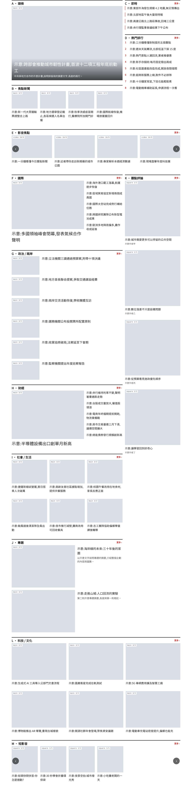</td></tr></table>

## 02

### 末列落單

- **問題**:次頭條 B 有 4 則,電腦設 4 欄;平板依規則推算成 3 欄,最後一列只剩 1 則。電腦 4 欄時標題也擠到 3 行。
- **改法**:B 改成 6 則,電腦沿用 P07 預設的 3 欄;平板推算為 2 欄。6 則在 2、3 欄都整除。

| | 比例 | 對齊 | 完整 | 密度 | 節奏 | 層級 | 文字 | 可用性 | 總分 |
| --- | --- | --- | --- | --- | --- | --- | --- | --- | --- |
| V1 | 100 | 40 | 70 | 80 | 70 | 90 | 70 | 70 | 74 |
| V2 | 100 | 40 | 100 | 80 | 70 | 90 | 70 | 70 | **78** |

✅ 第 1 層:V1 錯誤 0、V2 錯誤 0 ✅ 總分提升:74 → 78 ✅ 目標:末列不落單@B:fail → pass ✅ 沒有新的不合格:無

**V2 仍有的問題(8 個項目)**:這些不是本範例的目標,多半是[參數內無解的型式限制](發現與型式限制.md)或網站設定。

- ❌ **同型不連續**(F、G、H):F、G、H 連續 3 塊都是 P09
- ❌ **標題行數**(A(疊字)):疊字標題 3 行(360px)
- ❌ **觸控目標**(C、D、E 等 11 個):最小觸控目標 37px(「更多 ›」)(360px)
- ❌ **欄底對齊**(F、G、H):右欄底部留白 161px(左 441px、右 280px,差 36%)(1440px)
- ❌ **欄高**(section top、section sections):右欄底部留白 636px(1232px / 596px,差 52%)(1440px)
- ⚠️ **放大型不相鄰**(F、G;G、H;H、I):相鄰的放大型 3 組
- ⚠️ **填充率**(I):文字區 ÷ 圖高 = 48%(1024px)
- ⚠️ **輪播填滿**(M):4 則,一次顯示 6 張(1024px)

<table><tr><th>V1(768px)</th><th>V2(768px)</th></tr><tr><td valign="top"></td><td valign="top"></td></tr></table>

## 03

### 疊字標題過長

- **問題**:頭條 A 是疊字型(P01),標題 23 個中文字;360px 手機估 3 行,超過疊字上限 2 行,會被截斷。
- **改法**:編輯把標題縮短到 17 字,手機 2 行內。(另一條路是斷點下換型 P02,留待第 3 階段渲染器支援。)

| | 比例 | 對齊 | 完整 | 密度 | 節奏 | 層級 | 文字 | 可用性 | 總分 |
| --- | --- | --- | --- | --- | --- | --- | --- | --- | --- |
| V1 | 100 | 40 | 70 | 80 | 70 | 90 | 70 | 70 | 74 |
| V2 | 100 | 40 | 70 | 80 | 70 | 90 | 90 | 70 | **76** |

✅ 第 1 層:V1 錯誤 0、V2 錯誤 0 ✅ 總分提升:74 → 76 ✅ 目標:標題行數@A(疊字):fail → pass ✅ 沒有新的不合格:無

**V2 仍有的問題(9 個項目)**:這些不是本範例的目標,多半是[參數內無解的型式限制](發現與型式限制.md)或網站設定。

- ❌ **末列不落單**(B):4 則 ÷ 3 欄,餘 1(768px)
- ❌ **同型不連續**(F、G、H):F、G、H 連續 3 塊都是 P09
- ❌ **觸控目標**(C、D、E 等 11 個):最小觸控目標 37px(「更多 ›」)(360px)
- ❌ **欄底對齊**(F、G、H):右欄底部留白 161px(左 441px、右 280px,差 36%)(1440px)
- ❌ **欄高**(section top、section sections):右欄底部留白 1127px(2783px / 1656px,差 40%)(1024px)
- ⚠️ **放大型不相鄰**(F、G;G、H;H、I):相鄰的放大型 3 組
- ⚠️ **填充率**(I):文字區 ÷ 圖高 = 48%(1024px)
- ⚠️ **標題行數**(B):最多 3 行(1280px)
- ⚠️ **輪播填滿**(M):4 則,一次顯示 6 張(1024px)

<table><tr><th>V1(360px)</th><th>V2(360px)</th></tr><tr><td valign="top">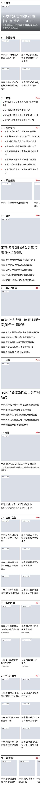</td><td valign="top">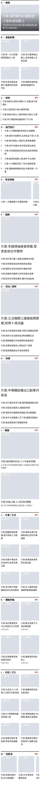</td></tr></table>

## 04

### 輪播右側留白

- **問題**:短影音 M 只有 4 則,但電腦一次顯示 6 張,右側留白。
- **改法**:電腦改成一次顯示 4 張。

| | 比例 | 對齊 | 完整 | 密度 | 節奏 | 層級 | 文字 | 可用性 | 總分 |
| --- | --- | --- | --- | --- | --- | --- | --- | --- | --- |
| V1 | 100 | 40 | 70 | 80 | 70 | 90 | 70 | 70 | 74 |
| V2 | 100 | 40 | 70 | 90 | 70 | 90 | 70 | 70 | **75** |

✅ 第 1 層:V1 錯誤 0、V2 錯誤 0 ✅ 總分提升:74 → 75 ✅ 目標:輪播填滿@M:warn → pass ✅ 沒有新的不合格:無

**V2 仍有的問題(8 個項目)**:這些不是本範例的目標,多半是[參數內無解的型式限制](發現與型式限制.md)或網站設定。

- ❌ **末列不落單**(B):4 則 ÷ 3 欄,餘 1(768px)
- ❌ **同型不連續**(F、G、H):F、G、H 連續 3 塊都是 P09
- ❌ **標題行數**(A(疊字)、B):疊字標題 3 行(360px)
- ❌ **觸控目標**(C、D、E 等 11 個):最小觸控目標 37px(「更多 ›」)(360px)
- ❌ **欄底對齊**(F、G、H):右欄底部留白 161px(左 441px、右 280px,差 36%)(1440px)
- ❌ **欄高**(section top、section sections):右欄底部留白 1127px(2783px / 1656px,差 40%)(1024px)
- ⚠️ **放大型不相鄰**(F、G;G、H;H、I):相鄰的放大型 3 組
- ⚠️ **填充率**(I):文字區 ÷ 圖高 = 48%(1024px)

<table><tr><th>V1(1280px)</th><th>V2(1280px)</th></tr><tr><td valign="top"></td><td valign="top">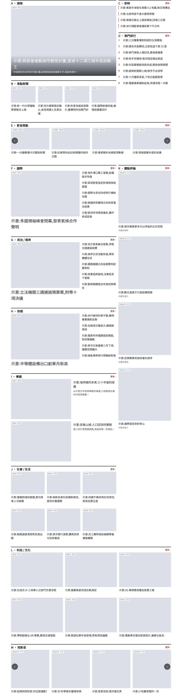</td></tr></table>

## 05

### 手機區塊太長

- **問題**:熱門排行 D 改成每則帶 1:1 縮圖,並增加到 10 則;手機上縮圖約佔 1/3 寬,整塊超過 1.5 屏。
- **改法**:熱門排行改回純文字清單(P05 允許無圖),10 則保留。

| | 比例 | 對齊 | 完整 | 密度 | 節奏 | 層級 | 文字 | 可用性 | 總分 |
| --- | --- | --- | --- | --- | --- | --- | --- | --- | --- |
| V1 | 100 | 40 | 70 | 70 | 70 | 90 | 70 | 70 | 73 |
| V2 | 100 | 40 | 70 | 80 | 70 | 90 | 70 | 70 | **74** |

✅ 第 1 層:V1 錯誤 0、V2 錯誤 0 ✅ 總分提升:73 → 74 ✅ 目標:區塊長度@D:warn → pass ✅ 沒有新的不合格:無

**V2 仍有的問題(9 個項目)**:這些不是本範例的目標,多半是[參數內無解的型式限制](發現與型式限制.md)或網站設定。

- ❌ **末列不落單**(B):4 則 ÷ 3 欄,餘 1(768px)
- ❌ **同型不連續**(F、G、H):F、G、H 連續 3 塊都是 P09
- ❌ **標題行數**(A(疊字)、B):疊字標題 3 行(360px)
- ❌ **觸控目標**(C、D、E 等 11 個):最小觸控目標 37px(「更多 ›」)(360px)
- ❌ **欄底對齊**(F、G、H):右欄底部留白 161px(左 441px、右 280px,差 36%)(1440px)
- ❌ **欄高**(section top、section sections):右欄底部留白 1127px(2783px / 1656px,差 40%)(1024px)
- ⚠️ **放大型不相鄰**(F、G;G、H;H、I):相鄰的放大型 3 組
- ⚠️ **填充率**(I):文字區 ÷ 圖高 = 48%(1024px)
- ⚠️ **輪播填滿**(M):4 則,一次顯示 6 張(1024px)

<table><tr><th>V1(390px)</th><th>V2(390px)</th></tr><tr><td valign="top">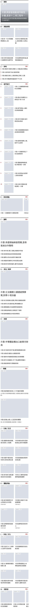</td><td valign="top">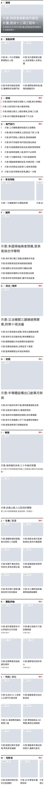</td></tr></table>

## 06

### 觸控目標太小

- **問題**:每塊標題列的「更多」連結只有 37px 高(標題列 40px 扣掉上框線 3px),低於 44px。
- **改法**:網站設定的區塊標題列加高到 48px。

| | 比例 | 對齊 | 完整 | 密度 | 節奏 | 層級 | 文字 | 可用性 | 總分 |
| --- | --- | --- | --- | --- | --- | --- | --- | --- | --- |
| V1 | 100 | 40 | 70 | 80 | 70 | 90 | 70 | 70 | 74 |
| V2 | 100 | 40 | 70 | 80 | 70 | 90 | 70 | 100 | **78** |

✅ 第 1 層:V1 錯誤 0、V2 錯誤 0 ✅ 總分提升:74 → 78 ✅ 目標:觸控目標:fail → pass ✅ 沒有新的不合格:無

**V2 仍有的問題(8 個項目)**:這些不是本範例的目標,多半是[參數內無解的型式限制](發現與型式限制.md)或網站設定。

- ❌ **末列不落單**(B):4 則 ÷ 3 欄,餘 1(768px)
- ❌ **同型不連續**(F、G、H):F、G、H 連續 3 塊都是 P09
- ❌ **標題行數**(A(疊字)、B):疊字標題 3 行(360px)
- ❌ **欄底對齊**(F、G、H):右欄底部留白 161px(左 441px、右 280px,差 36%)(1440px)
- ❌ **欄高**(section top、section sections):右欄底部留白 1159px(2823px / 1664px,差 41%)(1024px)
- ⚠️ **放大型不相鄰**(F、G;G、H;H、I):相鄰的放大型 3 組
- ⚠️ **填充率**(I):文字區 ÷ 圖高 = 48%(1024px)
- ⚠️ **輪播填滿**(M):4 則,一次顯示 6 張(1024px)

<table><tr><th>V1(390px)</th><th>V2(390px)</th></tr><tr><td valign="top">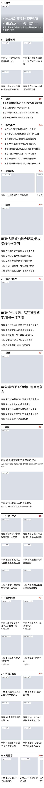</td><td valign="top">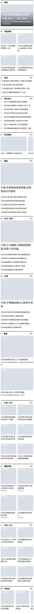</td></tr></table>

## 07

### 整頁則數太多

- **問題**:影音與短影音各塞到 12 則、社會與科技各 9 則,整頁 83 則,超過上限 80 則。
- **改法**:回到原本的則數(整頁 61 則)。

| | 比例 | 對齊 | 完整 | 密度 | 節奏 | 層級 | 文字 | 可用性 | 總分 |
| --- | --- | --- | --- | --- | --- | --- | --- | --- | --- |
| V1 | 100 | 40 | 70 | 50 | 70 | 90 | 70 | 70 | 70 |
| V2 | 100 | 40 | 70 | 80 | 70 | 90 | 70 | 70 | **74** |

✅ 第 1 層:V1 錯誤 0、V2 錯誤 0 ✅ 總分提升:70 → 74 ✅ 目標:整頁則數:fail → pass ✅ 沒有新的不合格:無

**V2 仍有的問題(9 個項目)**:這些不是本範例的目標,多半是[參數內無解的型式限制](發現與型式限制.md)或網站設定。

- ❌ **末列不落單**(B):4 則 ÷ 3 欄,餘 1(768px)
- ❌ **同型不連續**(F、G、H):F、G、H 連續 3 塊都是 P09
- ❌ **標題行數**(A(疊字)、B):疊字標題 3 行(360px)
- ❌ **觸控目標**(C、D、E 等 11 個):最小觸控目標 37px(「更多 ›」)(360px)
- ❌ **欄底對齊**(F、G、H):右欄底部留白 161px(左 441px、右 280px,差 36%)(1440px)
- ❌ **欄高**(section top、section sections):右欄底部留白 1127px(2783px / 1656px,差 40%)(1024px)
- ⚠️ **放大型不相鄰**(F、G;G、H;H、I):相鄰的放大型 3 組
- ⚠️ **填充率**(I):文字區 ÷ 圖高 = 48%(1024px)
- ⚠️ **輪播填滿**(M):4 則,一次顯示 6 張(1024px)

<table><tr><th>V1(1280px)</th><th>V2(1280px)</th></tr><tr><td valign="top">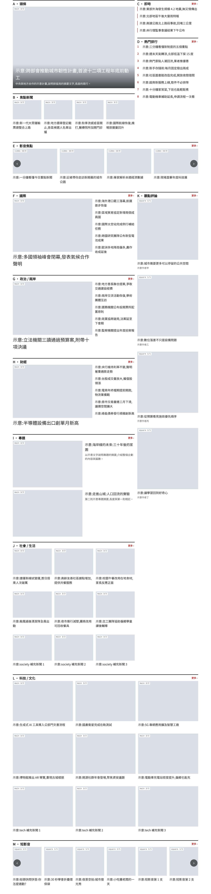</td><td valign="top">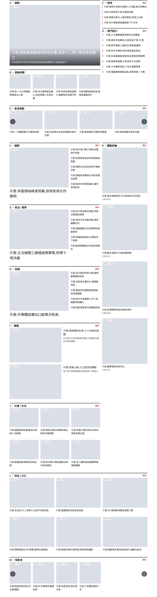</td></tr></table>

## 08

### 頭條重複

- **問題**:影音焦點下方又放了一塊頭條(P01),頭條變成兩塊,重點不明。
- **改法**:拿掉第二塊頭條。

| | 比例 | 對齊 | 完整 | 密度 | 節奏 | 層級 | 文字 | 可用性 | 總分 |
| --- | --- | --- | --- | --- | --- | --- | --- | --- | --- |
| V1 | 100 | 40 | 70 | 80 | 70 | 60 | 70 | 70 | 70 |
| V2 | 100 | 40 | 70 | 80 | 70 | 90 | 70 | 70 | **74** |

✅ 第 1 層:V1 錯誤 0、V2 錯誤 0 ✅ 總分提升:70 → 74 ✅ 目標:單塊不重複:fail → pass ✅ 沒有新的不合格:無

**V2 仍有的問題(9 個項目)**:這些不是本範例的目標,多半是[參數內無解的型式限制](發現與型式限制.md)或網站設定。

- ❌ **末列不落單**(B):4 則 ÷ 3 欄,餘 1(768px)
- ❌ **同型不連續**(F、G、H):F、G、H 連續 3 塊都是 P09
- ❌ **標題行數**(A(疊字)、B):疊字標題 3 行(360px)
- ❌ **觸控目標**(C、D、E 等 11 個):最小觸控目標 37px(「更多 ›」)(360px)
- ❌ **欄底對齊**(F、G、H):右欄底部留白 161px(左 441px、右 280px,差 36%)(1440px)
- ❌ **欄高**(section top、section sections):右欄底部留白 1127px(2783px / 1656px,差 40%)(1024px)
- ⚠️ **放大型不相鄰**(F、G;G、H;H、I):相鄰的放大型 3 組
- ⚠️ **填充率**(I):文字區 ÷ 圖高 = 48%(1024px)
- ⚠️ **輪播填滿**(M):4 則,一次顯示 6 張(1024px)

<table><tr><th>V1(1280px)</th><th>V2(1280px)</th></tr><tr><td valign="top">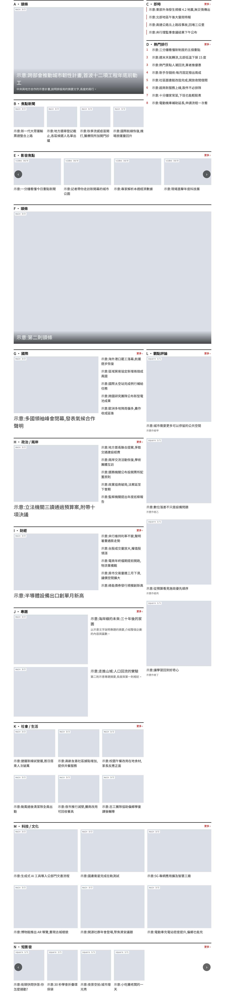</td><td valign="top"></td></tr></table>

## 09

### 區塊太多

- **問題**:頁尾再加 6 塊「更多國際」(P07,各 3 則),整頁 19 塊,超過上限 18 塊。
- **改法**:拿掉補充區塊,回到 13 塊。

| | 比例 | 對齊 | 完整 | 密度 | 節奏 | 層級 | 文字 | 可用性 | 總分 |
| --- | --- | --- | --- | --- | --- | --- | --- | --- | --- |
| V1 | 100 | 40 | 70 | 40 | 70 | 90 | 70 | 70 | 69 |
| V2 | 100 | 40 | 70 | 80 | 70 | 90 | 70 | 70 | **74** |

✅ 第 1 層:V1 錯誤 0、V2 錯誤 0 ✅ 總分提升:69 → 74 ✅ 目標:區塊數:fail → pass ✅ 沒有新的不合格:無

**V2 仍有的問題(9 個項目)**:這些不是本範例的目標,多半是[參數內無解的型式限制](發現與型式限制.md)或網站設定。

- ❌ **末列不落單**(B):4 則 ÷ 3 欄,餘 1(768px)
- ❌ **同型不連續**(F、G、H):F、G、H 連續 3 塊都是 P09
- ❌ **標題行數**(A(疊字)、B):疊字標題 3 行(360px)
- ❌ **觸控目標**(C、D、E 等 11 個):最小觸控目標 37px(「更多 ›」)(360px)
- ❌ **欄底對齊**(F、G、H):右欄底部留白 161px(左 441px、右 280px,差 36%)(1440px)
- ❌ **欄高**(section top、section sections):右欄底部留白 1127px(2783px / 1656px,差 40%)(1024px)
- ⚠️ **放大型不相鄰**(F、G;G、H;H、I):相鄰的放大型 3 組
- ⚠️ **填充率**(I):文字區 ÷ 圖高 = 48%(1024px)
- ⚠️ **輪播填滿**(M):4 則,一次顯示 6 張(1024px)

<table><tr><th>V1(1280px)</th><th>V2(1280px)</th></tr><tr><td valign="top">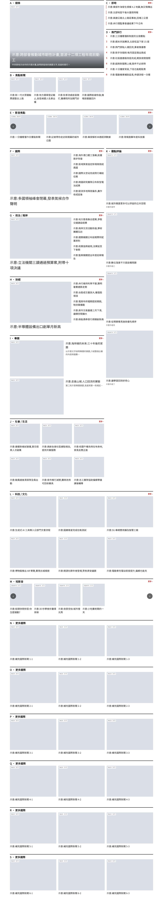</td><td valign="top"></td></tr></table>

## 10

### 貪婪法組合改法

- **問題**:範例首頁原樣(總分 74):同時有同型連續、末列落單、疊字標題過長、輪播留白、欄高失衡、觸控目標太小等問題。
- **改法**:由 greedy.ts 從 8 個候選改法中依序選出 5 個:1. G 換 P03、專題移到社會之後(範例 01)(79) 2. B 改 6 則、電腦 3 欄(範例 02)(83) 3. 頭條標題縮短到 17 字(範例 03)(86) 4. 區塊標題列加高到 48px(範例 06)(90) 5. 短影音電腦一次 4 張(範例 04)(91)。沒選上的候選不是不合法,就是會產生新的不合格,或沒有提升總分。

| | 比例 | 對齊 | 完整 | 密度 | 節奏 | 層級 | 文字 | 可用性 | 總分 |
| --- | --- | --- | --- | --- | --- | --- | --- | --- | --- |
| V1 | 100 | 40 | 70 | 80 | 70 | 90 | 70 | 70 | 74 |
| V2 | 100 | 40 | 100 | 90 | 100 | 100 | 100 | 100 | **91** |

✅ 第 1 層:V1 錯誤 0、V2 錯誤 0 ✅ 總分提升:74 → 91 ✅ 目標:標題行數:fail → pass ✅ 目標:末列不落單:fail → pass ✅ 目標:同型不連續:fail → pass ✅ 目標:觸控目標:fail → pass ✅ 沒有新的不合格:無

**V2 仍有的問題(3 個項目)**:這些不是本範例的目標,多半是[參數內無解的型式限制](發現與型式限制.md)或網站設定。

- ❌ **欄底對齊**(F、H):右欄底部留白 161px(左 441px、右 280px,差 36%)(1440px)
- ❌ **欄高**(section top、section sections):右欄底部留白 636px(1248px / 612px,差 51%)(1440px)
- ⚠️ **填充率**(J):文字區 ÷ 圖高 = 48%(1024px)

<table><tr><th>V1(1280px)</th><th>V2(1280px)</th></tr><tr><td valign="top"></td><td valign="top">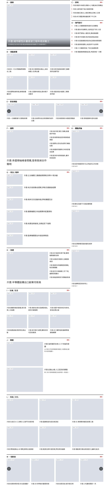</td></tr></table>
