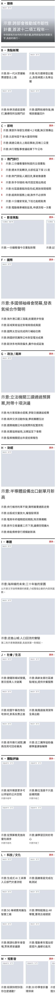
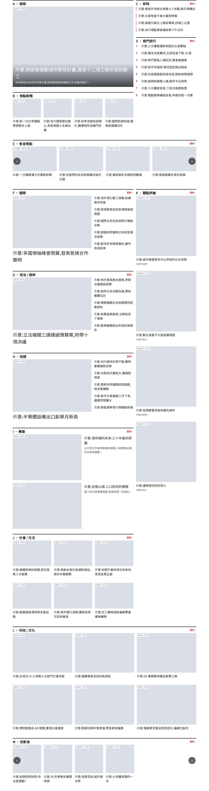

# POC 1 結果:JSON 估算 vs 實際渲染

> 由 `npm run poc:1` 產生,請勿手動編輯。量測環境:Chromium(Playwright)、字型 Noto Sans TC 400、deviceScaleFactor 1。

## 驗收

| # | 條件 | 結果 |
| --- | --- | --- |
| 1.1 | 13 塊 × 6 種寬度 = 78 筆 | ✅ 通過(78 筆) |
| 1.2 | 無水平捲動、圖框皆有 aspect-ratio、字型已載入 | ✅ 通過 |
| 1.3 | 連跑兩次結果相同 | 見 `npm run poc:1 -- --check-determinism` |
| 1.4 | 區塊高度誤差中位數 ≤ 5.0%、最大 ≤ 15.0%(取較好的標題方法:greedy) | ✅ 通過(中位數 0.0%,最大 0.0%) |

## 兩種標題行數方法

| 方法 | 說明 | 標題行數完全正確 | 估少 | 估多 | 區塊高度誤差中位數 | 最大 |
| --- | --- | --- | --- | --- | --- | --- |
| ratio | 規格公式:⌈總寬 ÷ 欄寬⌉ | 99.2% | 3 | 0 | 0.0% | 5.6% |
| greedy | 逐字排入,英數字不拆 | 100.0% | 0 | 0 | 0.0% | 0.0% |

共 360 個標題(疊字標題有兩行截斷,不列入)。

## 實測字寬

Noto Sans TC 實測:中文 1 em、英數字平均 0.534 em。估算用的設定值:中文 1 em、英數字 0.55 em。

## 誤差最大的 10 筆

| 寬度 | 版位 | 型 | 排法 | 區塊寬 | 估算 | 量測 | 誤差 |
| --- | --- | --- | --- | --- | --- | --- | --- |
| 360 | E | P12 | carousel | 344 | 271.75 | 271.73 | 0.0% |
| 1440 | M | P13 | carousel | 1304 | 322 | 321.98 | 0.0% |
| 768 | E | P12 | carousel | 704 | 413.5 | 413.48 | 0.0% |
| 1280 | H | P09 | lead-split | 738.67 | 427.19 | 427.17 | 0.0% |
| 1024 | J | P07 | grid | 618.67 | 924.67 | 924.63 | 0.0% |
| 1280 | F | P09 | lead-split | 738.67 | 469.19 | 469.17 | 0.0% |
| 1280 | G | P09 | lead-split | 738.67 | 469.19 | 469.17 | 0.0% |
| 1440 | I | P14 | feature-split | 858.67 | 711.41 | 711.38 | 0.0% |
| 1440 | F | P09 | lead-split | 858.67 | 480.52 | 480.5 | 0.0% |
| 1440 | G | P09 | lead-split | 858.67 | 480.52 | 480.5 | 0.0% |

## 每種寬度的明細

### 360px(mobile)

| 版位 | 型 | 排法 | 區塊寬 | 估算 ratio | 估算 greedy | 量測 | 誤差(greedy) |
| --- | --- | --- | --- | --- | --- | --- | --- |
| A | P01 | overlay | 344 | 269.33 | 269.33 | 269.33 | 0.0% |
| B | P07 | grid | 344 | 492.67 | 492.67 | 492.66 | 0.0% |
| C | P06 | list-timeline | 344 | 223 | 223 | 223 | 0.0% |
| D | P05 | list-number | 344 | 422 | 422 | 422 | 0.0% |
| E | P12 | carousel | 344 | 271.75 | 271.75 | 271.73 | 0.0% |
| F | P09 | lead-stack | 344 | 592.33 | 592.33 | 592.33 | 0.0% |
| G | P09 | lead-stack | 344 | 592.33 | 592.33 | 592.33 | 0.0% |
| H | P09 | lead-stack | 344 | 592.33 | 592.33 | 592.33 | 0.0% |
| I | P14 | feature-stack | 344 | 702.67 | 702.67 | 702.66 | 0.0% |
| J | P07 | grid | 344 | 704 | 704 | 703.98 | 0.0% |
| K | P17 | grid | 344 | 598 | 598 | 598 | 0.0% |
| L | P07 | grid | 344 | 650 | 677 | 676.98 | 0.0% |
| M | P13 | carousel | 344 | 259.82 | 259.82 | 259.81 | 0.0% |

### 390px(mobile)

| 版位 | 型 | 排法 | 區塊寬 | 估算 ratio | 估算 greedy | 量測 | 誤差(greedy) |
| --- | --- | --- | --- | --- | --- | --- | --- |
| A | P01 | overlay | 374 | 289.33 | 289.33 | 289.33 | 0.0% |
| B | P07 | grid | 374 | 458.67 | 485.67 | 485.66 | 0.0% |
| C | P06 | list-timeline | 374 | 196 | 196 | 196 | 0.0% |
| D | P05 | list-number | 374 | 368 | 368 | 368 | 0.0% |
| E | P12 | carousel | 374 | 258.81 | 258.81 | 258.8 | 0.0% |
| F | P09 | lead-stack | 374 | 612.33 | 612.33 | 612.33 | 0.0% |
| G | P09 | lead-stack | 374 | 612.33 | 612.33 | 612.33 | 0.0% |
| H | P09 | lead-stack | 374 | 612.33 | 612.33 | 612.33 | 0.0% |
| I | P14 | feature-stack | 374 | 742.67 | 742.67 | 742.66 | 0.0% |
| J | P07 | grid | 374 | 680 | 680 | 679.98 | 0.0% |
| K | P17 | grid | 374 | 628 | 628 | 628 | 0.0% |
| L | P07 | grid | 374 | 680 | 680 | 679.98 | 0.0% |
| M | P13 | carousel | 374 | 273.45 | 273.45 | 273.45 | 0.0% |

### 768px(tablet-V)

| 版位 | 型 | 排法 | 區塊寬 | 估算 ratio | 估算 greedy | 量測 | 誤差(greedy) |
| --- | --- | --- | --- | --- | --- | --- | --- |
| A | P01 | overlay | 704 | 509.33 | 509.33 | 509.33 | 0.0% |
| B | P07 | grid | 704 | 518.67 | 518.67 | 518.66 | 0.0% |
| C | P06 | list-timeline | 704 | 196 | 196 | 196 | 0.0% |
| D | P05 | list-number | 704 | 368 | 368 | 368 | 0.0% |
| E | P12 | carousel | 704 | 413.5 | 413.5 | 413.48 | 0.0% |
| F | P09 | lead-stack | 704 | 790.33 | 790.33 | 790.33 | 0.0% |
| G | P09 | lead-stack | 704 | 790.33 | 790.33 | 790.33 | 0.0% |
| H | P09 | lead-stack | 704 | 790.33 | 790.33 | 790.33 | 0.0% |
| I | P14 | feature-stack | 704 | 1158.67 | 1158.67 | 1158.66 | 0.0% |
| J | P07 | grid | 704 | 929 | 929 | 928.98 | 0.0% |
| K | P17 | grid | 704 | 3232 | 3232 | 3232 | 0.0% |
| L | P07 | grid | 704 | 929 | 929 | 928.98 | 0.0% |
| M | P13 | carousel | 704 | 396.45 | 396.45 | 396.45 | 0.0% |

### 1024px(tablet-H)

| 版位 | 型 | 排法 | 區塊寬 | 估算 ratio | 估算 greedy | 量測 | 誤差(greedy) |
| --- | --- | --- | --- | --- | --- | --- | --- |
| A | P01 | overlay | 618.67 | 452.44 | 452.44 | 452.44 | 0.0% |
| B | P07 | grid | 618.67 | 480.74 | 480.74 | 480.72 | 0.0% |
| C | P06 | list-timeline | 309.33 | 250 | 250 | 250 | 0.0% |
| D | P05 | list-number | 309.33 | 557 | 557 | 557 | 0.0% |
| E | P12 | carousel | 944 | 244 | 244 | 244 | 0.0% |
| F | P09 | lead-split | 618.67 | 415.85 | 415.85 | 415.84 | 0.0% |
| G | P09 | lead-split | 618.67 | 415.85 | 415.85 | 415.84 | 0.0% |
| H | P09 | lead-split | 618.67 | 374 | 374 | 374 | 0.0% |
| I | P14 | feature-split | 618.67 | 524.74 | 524.74 | 524.72 | 0.0% |
| J | P07 | grid | 618.67 | 924.67 | 924.67 | 924.63 | 0.0% |
| K | P17 | list-card | 309.33 | 1656.33 | 1656.33 | 1656.38 | -0.0% |
| L | P07 | grid | 944 | 1169 | 1169 | 1168.98 | 0.0% |
| M | P13 | carousel | 944 | 262 | 262 | 262 | 0.0% |

### 1280px(desktop)

| 版位 | 型 | 排法 | 區塊寬 | 估算 ratio | 估算 greedy | 量測 | 誤差(greedy) |
| --- | --- | --- | --- | --- | --- | --- | --- |
| A | P01 | overlay | 738.67 | 532.44 | 532.44 | 532.44 | 0.0% |
| B | P07 | grid | 738.67 | 260.11 | 260.11 | 260.11 | 0.0% |
| C | P06 | list-timeline | 369.33 | 196 | 196 | 196 | 0.0% |
| D | P05 | list-number | 369.33 | 368 | 368 | 368 | 0.0% |
| E | P12 | carousel | 1124 | 269.31 | 269.31 | 269.31 | 0.0% |
| F | P09 | lead-split | 738.67 | 469.19 | 469.19 | 469.17 | 0.0% |
| G | P09 | lead-split | 738.67 | 469.19 | 469.19 | 469.17 | 0.0% |
| H | P09 | lead-split | 738.67 | 427.19 | 427.19 | 427.17 | 0.0% |
| I | P14 | feature-split | 738.67 | 618.07 | 618.07 | 618.06 | 0.0% |
| J | P07 | grid | 738.67 | 534.07 | 534.07 | 534.06 | 0.0% |
| K | P17 | list-card | 369.33 | 1869.33 | 1869.33 | 1869.38 | -0.0% |
| L | P07 | grid | 1124 | 651.33 | 651.33 | 651.31 | 0.0% |
| M | P13 | carousel | 1124 | 292 | 292 | 292 | 0.0% |

### 1440px(desktop)

| 版位 | 型 | 排法 | 區塊寬 | 估算 ratio | 估算 greedy | 量測 | 誤差(greedy) |
| --- | --- | --- | --- | --- | --- | --- | --- |
| A | P01 | overlay | 858.67 | 612.44 | 612.44 | 612.44 | 0.0% |
| B | P07 | grid | 858.67 | 253.11 | 253.11 | 253.11 | 0.0% |
| C | P06 | list-timeline | 429.33 | 196 | 196 | 196 | 0.0% |
| D | P05 | list-number | 429.33 | 368 | 368 | 368 | 0.0% |
| E | P12 | carousel | 1304 | 267.63 | 267.63 | 267.63 | 0.0% |
| F | P09 | lead-split | 858.67 | 480.52 | 480.52 | 480.5 | 0.0% |
| G | P09 | lead-split | 858.67 | 480.52 | 480.52 | 480.5 | 0.0% |
| H | P09 | lead-split | 858.67 | 480.52 | 480.52 | 480.5 | 0.0% |
| I | P14 | feature-split | 858.67 | 711.41 | 711.41 | 711.38 | 0.0% |
| J | P07 | grid | 858.67 | 587.41 | 587.41 | 587.41 | 0.0% |
| K | P17 | list-card | 429.33 | 2109.33 | 2109.33 | 2109.38 | -0.0% |
| L | P07 | grid | 1304 | 731.33 | 731.33 | 731.31 | 0.0% |
| M | P13 | carousel | 1304 | 322 | 322 | 321.98 | 0.0% |

## 敏感度實驗:字型和設定不符時

估算參數不變(中文 1 em、英數字 0.55 em、半形標點 0.3 em),只把渲染字型換成系統的文泉驛正黑(實測中文 1 em、英數字 0.506 em)。

| 方法 | 標題行數完全正確 | 區塊高度誤差中位數 | 最大 |
| --- | --- | --- | --- |
| ratio | 98.9% | 0.0% | 6.0% |
| greedy | 99.7% | 0.0% | 6.0% |

## 截圖

| 390px | 1280px |
| --- | --- |
|  |  |
