# 範例:V1(改善前)→ V2(改善後)

> 由 `npm run poc:examples` 產生。每個範例都以 `data/` 為基礎,V1 用 JSON Patch 製造問題(或維持原樣),V2 在 V1 上套用改法;兩版都跑第 1 層檢查與完整評估。

**10 / 10 個範例通過驗收。** 驗收條件:兩版都沒有第 1 層錯誤、V2 總分高於 V1、目標項目在 V2 合格(標「部分」的範例只要求變好)、V2 沒有新的不合格項目。

| # | 範例 | 問題 | 總分 V1 → V2 | 整頁 V1 → V2 | 驗收 |
| --- | --- | --- | --- | --- | --- |
| 01 | 同型連續與放大型相鄰 | F、G、H 連續 3 塊都是 P09(首 1 則放大,其餘純文字),而且放大型 F~I 一路相鄰,看不出重點。 | 74 → **79** | 不合格 → 不合格 | ✅ |
| 02 | 末列落單 | 次頭條 B 有 4 則,電腦設 4 欄;平板依規則推算成 3 欄,最後一列只剩 1 則。電腦 4 欄時標題也擠到 3 行。 | 74 → **78** | 不合格 → 不合格 | ✅ |
| 03 | 疊字標題過長 | 頭條 A 是疊字型(P01),標題 23 個中文字;360px 手機估 3 行,超過疊字上限 2 行,會被截斷。 | 74 → **76** | 不合格 → 不合格 | ✅ |
| 04 | 輪播右側留白 | 短影音 M 只有 4 則,但電腦一次顯示 6 張,右側留白。 | 74 → **75** | 不合格 → 不合格 | ✅ |
| 05 | 手機區塊太長 | 熱門排行 D 改成每則帶 1:1 縮圖,並增加到 10 則;手機上縮圖約佔 1/3 寬,整塊超過 1.5 屏。 | 73 → **74** | 不合格 → 不合格 | ✅ |
| 06 | 觸控目標太小 | 每塊標題列的「更多」連結只有 37px 高(標題列 40px 扣掉上框線 3px),低於 44px。 | 74 → **78** | 不合格 → 不合格 | ✅ |
| 07 | 整頁則數太多 | 影音與短影音各塞到 12 則、社會與科技各 9 則,整頁 83 則,超過上限 80 則。 | 70 → **74** | 不合格 → 不合格 | ✅ |
| 08 | 頭條重複 | 影音焦點下方又放了一塊頭條(P01),頭條變成兩塊,重點不明。 | 70 → **74** | 不合格 → 不合格 | ✅ |
| 09 | 區塊太多 | 頁尾再加 6 塊「更多國際」(P07,各 3 則),整頁 19 塊,超過上限 18 塊。 | 69 → **74** | 不合格 → 不合格 | ✅ |
| 10 | 貪婪法組合改法 | 範例首頁原樣(總分 74):同時有同型連續、末列落單、疊字標題過長、輪播留白、欄高失衡、觸控目標太小等問題。 | 74 → **91** | 不合格 → 不合格 | ✅ |

## 01 同型連續與放大型相鄰

- **問題**:F、G、H 連續 3 塊都是 P09(首 1 則放大,其餘純文字),而且放大型 F~I 一路相鄰,看不出重點。
- **改法**:G 換成同分組的 P03 左圖右文;專題移到社會之後,讓放大型不再相鄰。

| 面向 | V1 | V2 |
| --- | --- | --- |
| 比例 | 100 | 100 |
| 對齊 | 40 | 40 |
| 完整 | 70 | 70 |
| 密度 | 80 | 80 |
| 節奏 | 70 | 100 |
| 層級 | 90 | 100 |
| 文字 | 70 | 70 |
| 可用性 | 70 | 70 |
| **總分** | **74** | **79** |

| 驗收 | 結果 | 說明 |
| --- | --- | --- |
| 第 1 層 | ✅ | V1 錯誤 0、V2 錯誤 0 |
| 總分提升 | ✅ | 74 → 79 |
| 目標:同型不連續 | ✅ | fail → pass |
| 目標:放大型不相鄰 | ✅ | warn → pass |
| 沒有新的不合格 | ✅ | 無 |

| V1 | V2 |
| --- | --- |
| 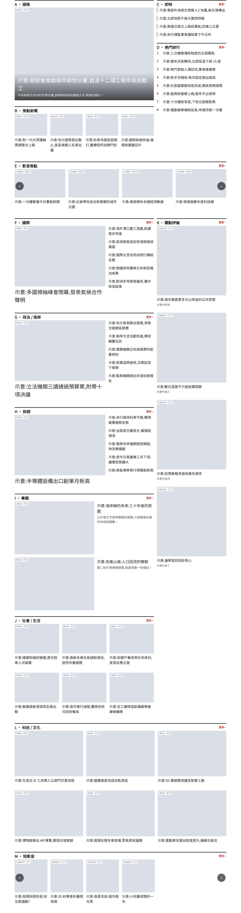 | 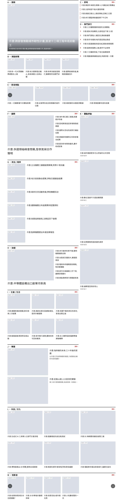 |

## 02 末列落單

- **問題**:次頭條 B 有 4 則,電腦設 4 欄;平板依規則推算成 3 欄,最後一列只剩 1 則。電腦 4 欄時標題也擠到 3 行。
- **改法**:B 改成 6 則,電腦沿用 P07 預設的 3 欄;平板推算為 2 欄。6 則在 2、3 欄都整除。

| 面向 | V1 | V2 |
| --- | --- | --- |
| 比例 | 100 | 100 |
| 對齊 | 40 | 40 |
| 完整 | 70 | 100 |
| 密度 | 80 | 80 |
| 節奏 | 70 | 70 |
| 層級 | 90 | 90 |
| 文字 | 70 | 70 |
| 可用性 | 70 | 70 |
| **總分** | **74** | **78** |

| 驗收 | 結果 | 說明 |
| --- | --- | --- |
| 第 1 層 | ✅ | V1 錯誤 0、V2 錯誤 0 |
| 總分提升 | ✅ | 74 → 78 |
| 目標:末列不落單@B | ✅ | fail → pass |
| 沒有新的不合格 | ✅ | 無 |

| V1 | V2 |
| --- | --- |
|  |  |

## 03 疊字標題過長

- **問題**:頭條 A 是疊字型(P01),標題 23 個中文字;360px 手機估 3 行,超過疊字上限 2 行,會被截斷。
- **改法**:編輯把標題縮短到 17 字,手機 2 行內。(另一條路是斷點下換型 P02,留待第 3 階段渲染器支援。)

| 面向 | V1 | V2 |
| --- | --- | --- |
| 比例 | 100 | 100 |
| 對齊 | 40 | 40 |
| 完整 | 70 | 70 |
| 密度 | 80 | 80 |
| 節奏 | 70 | 70 |
| 層級 | 90 | 90 |
| 文字 | 70 | 90 |
| 可用性 | 70 | 70 |
| **總分** | **74** | **76** |

| 驗收 | 結果 | 說明 |
| --- | --- | --- |
| 第 1 層 | ✅ | V1 錯誤 0、V2 錯誤 0 |
| 總分提升 | ✅ | 74 → 76 |
| 目標:標題行數@A(疊字) | ✅ | fail → pass |
| 沒有新的不合格 | ✅ | 無 |

| V1 | V2 |
| --- | --- |
| 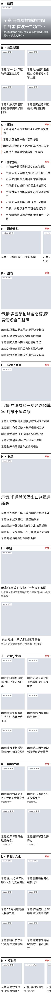 | 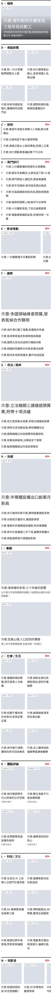 |

## 04 輪播右側留白

- **問題**:短影音 M 只有 4 則,但電腦一次顯示 6 張,右側留白。
- **改法**:電腦改成一次顯示 4 張。

| 面向 | V1 | V2 |
| --- | --- | --- |
| 比例 | 100 | 100 |
| 對齊 | 40 | 40 |
| 完整 | 70 | 70 |
| 密度 | 80 | 90 |
| 節奏 | 70 | 70 |
| 層級 | 90 | 90 |
| 文字 | 70 | 70 |
| 可用性 | 70 | 70 |
| **總分** | **74** | **75** |

| 驗收 | 結果 | 說明 |
| --- | --- | --- |
| 第 1 層 | ✅ | V1 錯誤 0、V2 錯誤 0 |
| 總分提升 | ✅ | 74 → 75 |
| 目標:輪播填滿@M | ✅ | warn → pass |
| 沒有新的不合格 | ✅ | 無 |

| V1 | V2 |
| --- | --- |
|  | 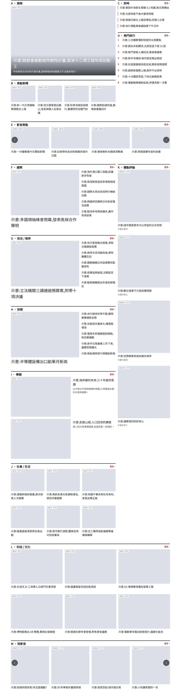 |

## 05 手機區塊太長

- **問題**:熱門排行 D 改成每則帶 1:1 縮圖,並增加到 10 則;手機上縮圖約佔 1/3 寬,整塊超過 1.5 屏。
- **改法**:熱門排行改回純文字清單(P05 允許無圖),10 則保留。

| 面向 | V1 | V2 |
| --- | --- | --- |
| 比例 | 100 | 100 |
| 對齊 | 40 | 40 |
| 完整 | 70 | 70 |
| 密度 | 70 | 80 |
| 節奏 | 70 | 70 |
| 層級 | 90 | 90 |
| 文字 | 70 | 70 |
| 可用性 | 70 | 70 |
| **總分** | **73** | **74** |

| 驗收 | 結果 | 說明 |
| --- | --- | --- |
| 第 1 層 | ✅ | V1 錯誤 0、V2 錯誤 0 |
| 總分提升 | ✅ | 73 → 74 |
| 目標:區塊長度@D | ✅ | warn → pass |
| 沒有新的不合格 | ✅ | 無 |

| V1 | V2 |
| --- | --- |
| 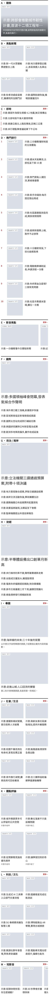 | 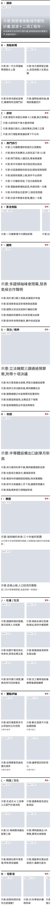 |

## 06 觸控目標太小

- **問題**:每塊標題列的「更多」連結只有 37px 高(標題列 40px 扣掉上框線 3px),低於 44px。
- **改法**:網站設定的區塊標題列加高到 48px。

| 面向 | V1 | V2 |
| --- | --- | --- |
| 比例 | 100 | 100 |
| 對齊 | 40 | 40 |
| 完整 | 70 | 70 |
| 密度 | 80 | 80 |
| 節奏 | 70 | 70 |
| 層級 | 90 | 90 |
| 文字 | 70 | 70 |
| 可用性 | 70 | 100 |
| **總分** | **74** | **78** |

| 驗收 | 結果 | 說明 |
| --- | --- | --- |
| 第 1 層 | ✅ | V1 錯誤 0、V2 錯誤 0 |
| 總分提升 | ✅ | 74 → 78 |
| 目標:觸控目標 | ✅ | fail → pass |
| 沒有新的不合格 | ✅ | 無 |

| V1 | V2 |
| --- | --- |
| 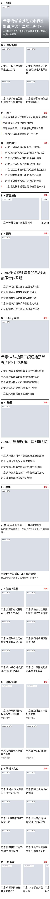 | 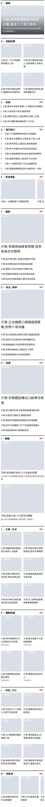 |

## 07 整頁則數太多

- **問題**:影音與短影音各塞到 12 則、社會與科技各 9 則,整頁 83 則,超過上限 80 則。
- **改法**:回到原本的則數(整頁 61 則)。

| 面向 | V1 | V2 |
| --- | --- | --- |
| 比例 | 100 | 100 |
| 對齊 | 40 | 40 |
| 完整 | 70 | 70 |
| 密度 | 50 | 80 |
| 節奏 | 70 | 70 |
| 層級 | 90 | 90 |
| 文字 | 70 | 70 |
| 可用性 | 70 | 70 |
| **總分** | **70** | **74** |

| 驗收 | 結果 | 說明 |
| --- | --- | --- |
| 第 1 層 | ✅ | V1 錯誤 0、V2 錯誤 0 |
| 總分提升 | ✅ | 70 → 74 |
| 目標:整頁則數 | ✅ | fail → pass |
| 沒有新的不合格 | ✅ | 無 |

| V1 | V2 |
| --- | --- |
| 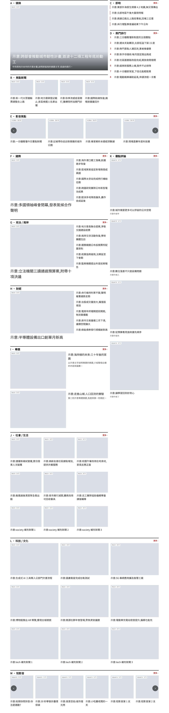 |  |

## 08 頭條重複

- **問題**:影音焦點下方又放了一塊頭條(P01),頭條變成兩塊,重點不明。
- **改法**:拿掉第二塊頭條。

| 面向 | V1 | V2 |
| --- | --- | --- |
| 比例 | 100 | 100 |
| 對齊 | 40 | 40 |
| 完整 | 70 | 70 |
| 密度 | 80 | 80 |
| 節奏 | 70 | 70 |
| 層級 | 60 | 90 |
| 文字 | 70 | 70 |
| 可用性 | 70 | 70 |
| **總分** | **70** | **74** |

| 驗收 | 結果 | 說明 |
| --- | --- | --- |
| 第 1 層 | ✅ | V1 錯誤 0、V2 錯誤 0 |
| 總分提升 | ✅ | 70 → 74 |
| 目標:單塊不重複 | ✅ | fail → pass |
| 沒有新的不合格 | ✅ | 無 |

| V1 | V2 |
| --- | --- |
| 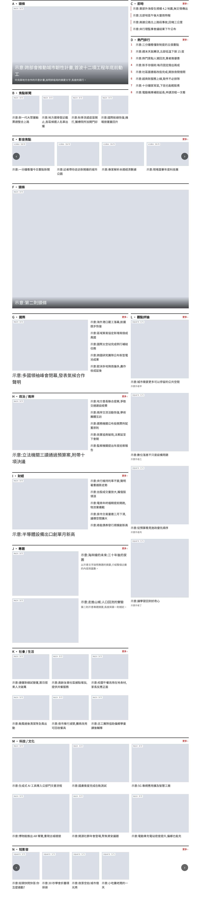 |  |

## 09 區塊太多

- **問題**:頁尾再加 6 塊「更多國際」(P07,各 3 則),整頁 19 塊,超過上限 18 塊。
- **改法**:拿掉補充區塊,回到 13 塊。

| 面向 | V1 | V2 |
| --- | --- | --- |
| 比例 | 100 | 100 |
| 對齊 | 40 | 40 |
| 完整 | 70 | 70 |
| 密度 | 40 | 80 |
| 節奏 | 70 | 70 |
| 層級 | 90 | 90 |
| 文字 | 70 | 70 |
| 可用性 | 70 | 70 |
| **總分** | **69** | **74** |

| 驗收 | 結果 | 說明 |
| --- | --- | --- |
| 第 1 層 | ✅ | V1 錯誤 0、V2 錯誤 0 |
| 總分提升 | ✅ | 69 → 74 |
| 目標:區塊數 | ✅ | fail → pass |
| 沒有新的不合格 | ✅ | 無 |

| V1 | V2 |
| --- | --- |
| 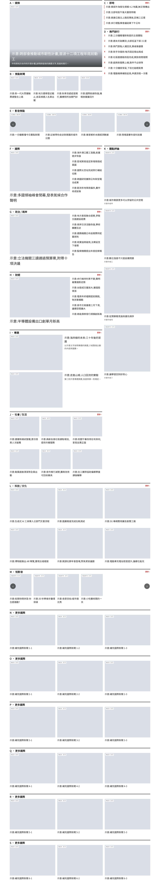 |  |

## 10 貪婪法組合改法

- **問題**:範例首頁原樣(總分 74):同時有同型連續、末列落單、疊字標題過長、輪播留白、欄高失衡、觸控目標太小等問題。
- **改法**:由 greedy.ts 從 8 個候選改法中依序選出 5 個:1. G 換 P03、專題移到社會之後(範例 01)(79) 2. B 改 6 則、電腦 3 欄(範例 02)(83) 3. 頭條標題縮短到 17 字(範例 03)(86) 4. 區塊標題列加高到 48px(範例 06)(90) 5. 短影音電腦一次 4 張(範例 04)(91)。沒選上的候選不是不合法,就是會產生新的不合格,或沒有提升總分。

| 面向 | V1 | V2 |
| --- | --- | --- |
| 比例 | 100 | 100 |
| 對齊 | 40 | 40 |
| 完整 | 70 | 100 |
| 密度 | 80 | 90 |
| 節奏 | 70 | 100 |
| 層級 | 90 | 100 |
| 文字 | 70 | 100 |
| 可用性 | 70 | 100 |
| **總分** | **74** | **91** |

| 驗收 | 結果 | 說明 |
| --- | --- | --- |
| 第 1 層 | ✅ | V1 錯誤 0、V2 錯誤 0 |
| 總分提升 | ✅ | 74 → 91 |
| 目標:標題行數 | ✅ | fail → pass |
| 目標:末列不落單 | ✅ | fail → pass |
| 目標:同型不連續 | ✅ | fail → pass |
| 目標:觸控目標 | ✅ | fail → pass |
| 沒有新的不合格 | ✅ | 無 |

| V1 | V2 |
| --- | --- |
|  | 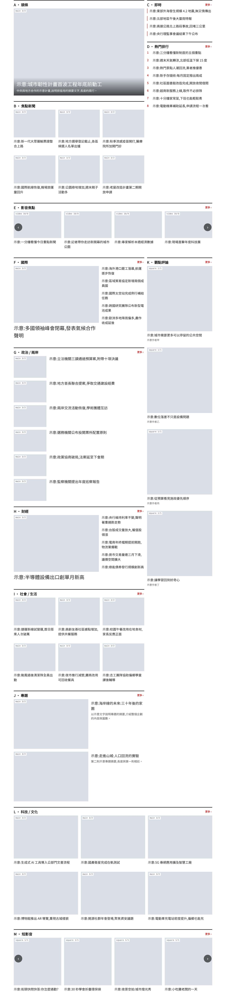 |
